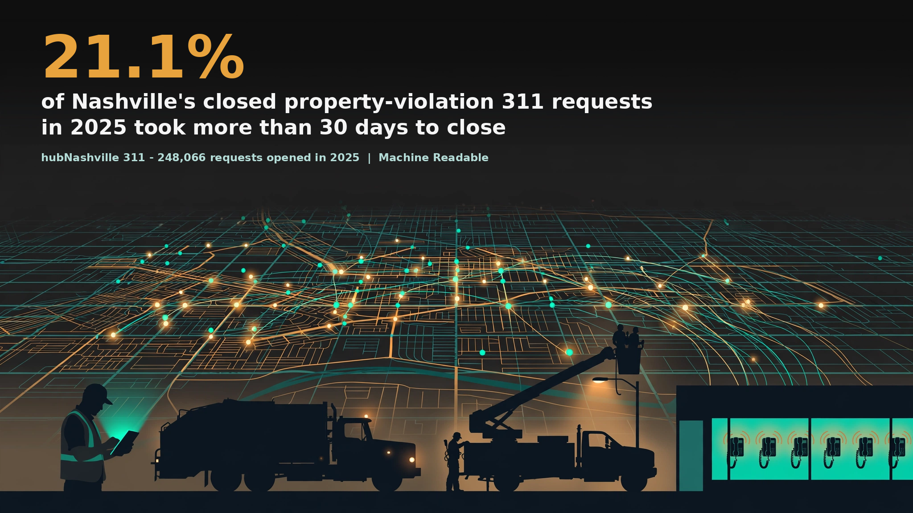

# Nashville 311 Service Requests - a Machine Readable data brief



Of the **248,066 service requests** opened with hubNashville in 2025, **78,753 (31.7 percent) were resolved on the first call** and every closed one of them closed the same day. Among the other 161,645 closed requests, 44.0 percent closed the same day and the median wait was 1 day, while closed property-violation requests (20,564) waited a median of 6 days and **21.1 percent of them took more than 30 days**.

Full brief: [brief-draft.md](brief-draft.md) | Sources: [sources.md](sources.md) | Verification: [verification.md](verification.md)

## Contents

- `brief-draft.md` - the brief
- `hero.png` - headline graphic (generated illustration, brand palette, headline composited on top)
- `charts/` - requests by type, median closure days by type, same-day share by type, slowest districts by median
- `stats.json` - every headline figure with its population printed
- `data/` - panels, the pre-flight audit output, the pull log, the source layer metadata, and the independent verifier output. The raw snapshot CSV is not carried in this repository; it is retained as a parquet in the project warehouse stack (stack/nashville/snapshots/2026-11-08/nashville_311_2025_raw.parquet) and is reproducible any time with `code/pull_data.py`
- `code/` - `pull_data.py`, `audit_section10.py`, `build_stats.py`, `add_derived.py`, `verify_independent.py`, `charts.py`, `hero_composite.py`
- `verification.md` - pre-flight audit summary, methods checklist, sync gate, story gate

## Reproduce

```
python3 code/pull_data.py          # 2025-window pull from the live service (snapshot will drift from the archived one)
python3 code/audit_section10.py    # writes data/audit_output.txt
python3 code/build_stats.py        # writes stats.json and data/*_panel.csv
python3 code/add_derived.py        # adds the first-call / fieldwork split blocks to stats.json
python3 code/verify_independent.py # second implementation (pandas) + live server counts
python3 code/charts.py
```

Dependencies (matching the code's actual imports): Python 3 standard library plus pandas (verifier only) and matplotlib + Pillow (charts and hero only). The build and audit scripts themselves use only the standard library.

## Source

hubNashville 311 Service Requests (full-series service), Metropolitan Government of Nashville and Davidson County via hubNashville open data, ArcGIS FeatureServer layer 0 (services2.arcgis.com/HdTo6HJqh92wn4D8). Snapshot November 8, 2026; analysis population opened in calendar 2025. Companion brief: [Denver 311](https://github.com/adowlen/denver-311-data-brief) (October 12, 2026).

## License

Brief text and derived data products: CC BY 4.0 (see LICENSE). Underlying records are Metro Nashville government open data.

*Machine Readable is a public-good civic data project by Alex Dowlen.*
